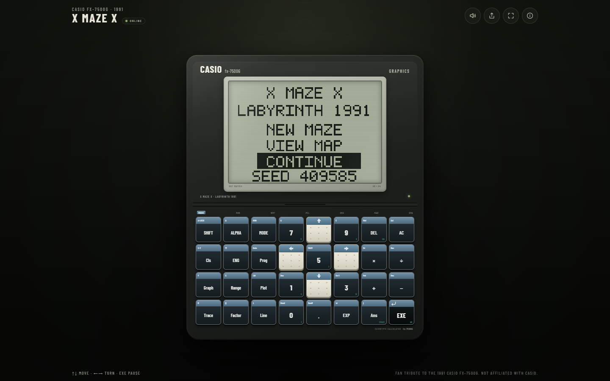
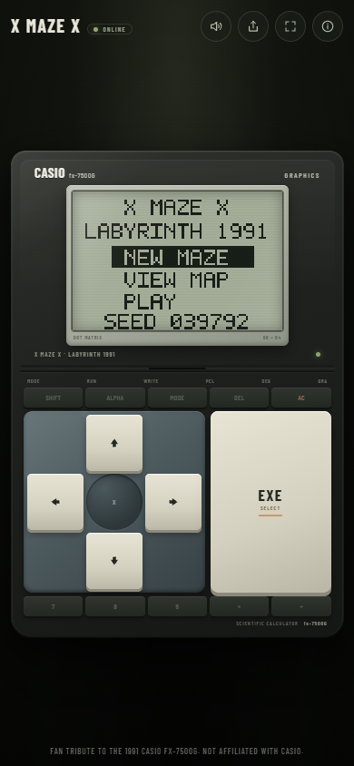

# X MAZE X — Labyrinth 1991

A browser revival of a 3D labyrinth started in 1991 on a **Casio FX-7500G**
graphic calculator. The original hand-written Casio BASIC program was 1091
steps long. Its 3D display code was lost; this version reconstructs the
wireframe corridors from the surviving notes.

Everything is drawn on an emulated **96 × 64 monochrome LCD** at 30 fps, in the
calculator's green-gray palette, with a subtle passive-LCD ghosting effect.

**Live demo:** <https://hipe-0.github.io/x-maze-x-labyrinth/>





## Play

Requires **Node.js 20** or newer.

```bash
npm ci        # or: npm install
npm run dev
```

Open the printed local URL. The Vite server is also exposed on the local
network, so you can open it on a phone during development.

## Controls

| Input | Action |
|---|---|
| `↑` / `W` | Forward |
| `↓` / `S` | Back |
| `←` / `A` | Turn left 90° |
| `→` / `D` | Turn right 90° |
| `Enter` / `Space` / `J` | Select in menus · pause during play |
| `Esc` | Back · pause / resume |

On touch devices, the white dotted arrow keys and the black **EXE** key are the
only active calculator keys. The rest of the keypad is drawn but disabled for
now.

## Screens

- **Title** — `NEW MAZE`, `VIEW MAP`, and `CONTINUE` (or `PLAY` when there is
  no saved game).
- **Play** — the 3D wireframe corridor.
- **Pause** — `RESUME`, `VIEW MAP`, `NEW MAZE`, `MAIN MENU`.
- **Map** — the top-down 20 × 18 maze. `EXE` returns to the previous screen.
- **Win** — `YOU WIN`, the 1091-step homage, and the seed.

## Save and sharing

- The current maze and player position are saved to `localStorage` after every
  move. `CONTINUE` restores them.
- The seed is shown on the title and win screens.
- The share button copies a URL like `?seed=001991`. Opening that URL starts the
  exact maze immediately.
- The build uses a relative base, so it works from any GitHub Pages project
  path.
- No backend, accounts, analytics or tracking.

## Tech

- React 19 + TypeScript + Vite
- Canvas 2D for the fixed 96 × 64 framebuffer
- Plain CSS/SVG for the calculator shell and controls
- Vitest for maze, movement, pause/map, save and win tests
- 30 fps fixed game loop with the original two-frame LCD ghost decay

The renderer is kept behind the `Game`/`Framebuffer` boundary, so a future
Three.js mode can be added without changing the maze logic.

## Development

```bash
npm run dev       # Vite dev server
npm test          # 41 unit tests
npm run lint      # oxlint
npm run build     # production build in dist/
npm run preview   # preview the production build
```

See [PLAN.md](PLAN.md) for the improvement roadmap.

### VS Code

Open this folder in VS Code and press **Ctrl+Shift+B** to run the default build
task, **Dev: start server**. The integrated terminal prints the local URL; the
task keeps running so the dev server stays up. Stop it with `Ctrl+C` or the
terminal trash icon.

`Terminal → Run Task…` also lists **Dev: open app in browser**, which opens
`http://localhost:5173/` in your default browser.

The task is defined in `.vscode/tasks.json`.

## Deploy to GitHub Pages

The repository includes `.github/workflows/deploy.yml`, which lints, tests,
builds and deploys the site on every push to `main`.

1. In the repository: **Settings → Pages → Build and deployment → Source**,
   choose **GitHub Actions**.
2. The site is published at
   <https://hipe-0.github.io/x-maze-x-labyrinth/>.

No repository-name configuration is needed: `vite.config.ts` uses
`base: './'`, so forks and renamed repositories work from any project path.

## The 1991 game

The maze is 20 × 18 cells inside a two-cell border ring. You start in the west
vestibule facing east and must reach the opening in the east border wall
(`w = 22`) to win. The seed determines the maze. The original 1991 notes and
code pages are not included in this repository.

## Credits

Designed and built by Hippolyte Mounier. The 1991 concept, the original Casio
BASIC program and the surviving design notes are the author's own archive.

**Fan project. Not affiliated with Casio.**

## License

Released under the [Apache License 2.0](LICENSE). © 2026 Hippolyte Mounier.
